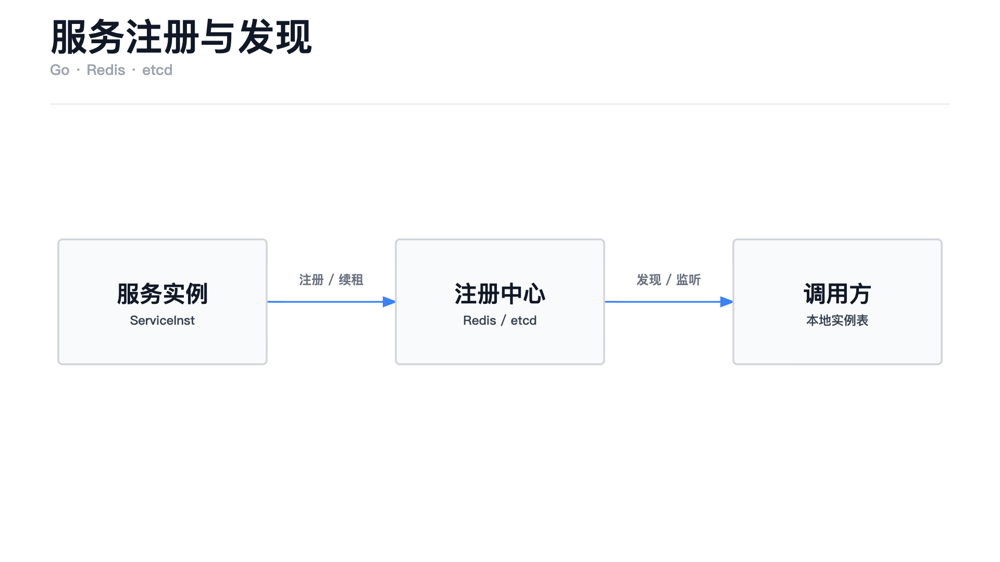
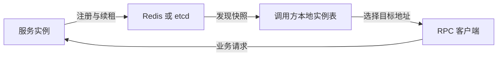

# 用 Go 实现服务注册与发现：Redis 与 etcd 双后端设计



服务拆成多个进程以后，调用方首先遇到的问题是：目标服务现在运行在哪些地址上？

把地址写进配置可以启动系统，但实例扩容、重启和下线以后，调用方还要跟着更新。服务注册与发现就是把这部分工作集中起来：服务端登记自己，调用方获取实例列表，并持续接收变化。

本文结合 ngame 的实现，介绍如何在同一组 Go 接口下支持 Redis 和 etcd。重点是注册的生命周期、所有权，以及发现列表如何保持更新。

## 1. 先划清注册中心的职责

注册中心记录的是服务实例，例如：

```text
player
  ├─ player-a → 10.0.0.11:9000
  └─ player-b → 10.0.0.12:9000

room
  └─ room-a   → 10.0.0.21:9000
```

它提供实例身份、服务名称、RPC 地址和声明的服务状态。调用方拿到这些数据以后，再决定选择哪个实例、如何建立 RPC 连接。

几个容易混在一起的职责，可以这样区分：

| 组件 | 回答的问题 |
| --- | --- |
| 服务发现 | `player-b` 的 RPC 地址是什么？有哪些 Player 实例？ |
| 负载均衡 | 这次新请求选择哪个可用实例？ |
| 位置定位 Locator | 玩家 1001 的状态属于哪个实例？ |
| RPC | 怎样向选中的实例发起调用？ |

玩家绑定在哪个网关、房间由哪个节点管理，属于业务对象的位置定位。它们不进入服务实例列表。`player`、`room`、`gate` 也只是业务定义的服务名，框架不要求这些角色必须存在。

## 2. 一个服务实例需要保存什么

ngame 使用下面的结构描述服务实例：

```go
type ServiceInst struct {
    Id      string            `json:"id"`
    Name    string            `json:"name"`
    RpcHost string            `json:"rpc_host"`
    RpcPort int               `json:"rpc_port"`
    Status  Status            `json:"status"`
    Weight  int               `json:"weight"`
    Meta    map[string]string `json:"meta"`
}
```

`Name` 用于聚合同类实例，`Id` 标识某次进程启动提供的实例。同一命名空间内 Id 必须唯一，每次启动都生成新的 Id，避免把重启前后的进程当成同一个实例。

注册地址必须能被其他服务访问。如果监听 `0.0.0.0:9000`，登记的应当是实际可访问的 IP 或主机名；如果监听端口传入 `0`，则必须等操作系统分配端口后，登记实际端口。

实例状态显式定义：

```go
const (
    Working  Status = 0
    Hung     Status = 1
    Shutdown Status = 2
)
```

`Working` 表示正常服务；`Hung` 表示暂停参与负载均衡，已有业务的定向调用由业务层决定；`Shutdown` 表示正在退出，不再接收新请求。发现接口会返回所有状态，由调用方筛选目标。修改状态不会自动拦截 RPC，请求入口也需要执行相应的接入策略。

`Weight` 是配置权重，正数参与加权选择，0 不参与。CPU、内存、活跃玩家数、房间数和队列积压属于运行指标，可以用于节点选择，但不应靠高频改写实例注册信息来上报。

## 3. 用注册句柄管理生命周期

一次注册包含自动续租、信息更新、注销和失效通知。为了让这些操作有明确归属，`Register` 返回一个注册句柄：

```go
type Registry interface {
    Register(
        ctx context.Context,
        instance endpoint.ServiceInst,
    ) (Registration, error)
}

type Registration interface {
    Update(ctx context.Context, instance endpoint.ServiceInst) error
    UpdateMeta(ctx context.Context, meta map[string]string) error
    Unregister(ctx context.Context) error
    Done() <-chan struct{}
}
```

调用方拿到的是“管理这一次注册”的能力。因此，更新和注销时不需要再次传入一个可以随意指定的实例 Id。

接口语义也需要明确：

- `Update` 整体替换实例信息，Id 和 Name 保持不变。
- `UpdateMeta` 只替换元信息，nil 或空 map 表示清空。
- `Unregister` 停止续租并尝试删除记录，重复调用安全。
- `Done` 在主动注销或注册失效时关闭，失效后不会自动重新注册。

`UpdateMeta` 采用整体替换语义。假设原来是 `{"zone":"1","build":"a"}`，传入 `{"build":"b"}` 后，结果就是 `{"build":"b"}`，不会保留旧的 `zone`。

### 注册操作的超时，不等于注册的生命周期

业务通常会给注册操作设置超时：

```go
registerCtx, cancel := context.WithTimeout(ctx, 3*time.Second)
registration, err := store.Register(registerCtx, instance)
cancel()
if err != nil {
    return err
}
```

这里的 ctx 只约束本次注册操作。成功返回以后，自动续租由句柄管理，取消 `registerCtx` 不会撤销注册。

业务层通过 `registration.Done()` 感知失效，再决定停止接收请求、退出进程或者重新申请注册。框架不自动重新注册，因为原有业务状态是否还允许继续提供服务，需要由业务层判断。

注销时即使请求超时，也要停止本地续租并关闭 Done。删除失败的记录随后过期；调用方也可以再次调用 `Unregister`。停机阶段的注销应使用单独的清理 context，避免直接复用已经取消的运行 context。

## 4. 为什么注销必须校验所有权

单纯使用 `实例 Id → 实例信息`，然后按 Id 删除，会遇到一个实际问题：

```text
旧注册 A 持有实例记录
    ↓
旧记录过期或被移除
    ↓
新注册 B 使用相同 Id 注册成功
    ↓
A 的延迟注销到达
```

如果 A 直接删除这个 Id，就会删掉 B 的记录。正常部署每次启动都换新 Id，可以减少这类冲突；存储操作仍然需要校验自己拥有哪次注册。

因此，实例 Id 和注册所有权是两个概念：实例 Id 用于查找，所有权用于约束更新、续租和删除。Redis 用随机 owner 标识，etcd 用每次注册独立的 Lease。

句柄的方法还需要处理本地并发：`Update`、`UpdateMeta` 和 `Unregister` 使用互斥保护。注销先取消注册生命周期，使正在执行的更新能够收到取消，再执行存储清理。已经结束的句柄不能重新创建记录。

## 5. Redis：字段 TTL、所有权和通知

### 数据组织

Redis 后端沿用 Hash 字段过期机制，使用两个 Hash：

```text
{ngame:prod:zone-1}:instances
    实例 Id → ServiceInst 的 JSON

{ngame:prod:zone-1}:owners
    实例 Id → 当前注册的随机 owner

{ngame:prod:zone-1}:changed
    Pub/Sub 变更通知频道
```

两个 Hash 使用相同的 hash tag，放在同一个 Redis Cluster hash slot 中，供 Lua 脚本一起操作。实例数据和 owner 对应的字段都设置 TTL。

这里要求 **Redis 7.4+**，因为使用了从 7.4 开始提供的 Hash 字段过期命令 `HEXPIRE`。[命令说明](https://redis.io/docs/latest/commands/hexpire/)

### 注册、续期和更新

注册脚本先判断实例字段是否存在。存在则返回重复注册错误，不覆盖已有记录；不存在才写入实例、owner 和字段 TTL，然后发布变更通知。

自动续期间隔为 TTL/3。续期脚本只有在 owner 匹配、实例字段仍然存在时才刷新过期时间。更新实例也检查这两个条件，再替换 JSON、刷新 TTL 并发送通知。

这些逻辑放在独立的 `.lua` 文件中，通过 `go:embed` 加载。比较和写入在一次脚本执行中完成，避免客户端先检查、再修改时被其他注册穿插执行。

注销脚本同样先比较 owner：

```lua
if redis.call('HGET', KEYS[2], ARGV[1]) ~= ARGV[2] then
    return 0
end

redis.call('HDEL', KEYS[1], ARGV[1])
redis.call('HDEL', KEYS[2], ARGV[1])
redis.call('PUBLISH', ARGV[3], ARGV[1])
return 1
```

这里 `ARGV[1]` 是实例 Id，`ARGV[2]` 是当前句柄持有的 owner。即使旧句柄延迟执行，也无法删除 owner 已经变化的记录。

### 通知用于加速，定时读取负责同步

Redis Pub/Sub 不保存可回放的消息，断线期间的通知可能丢失。[投递语义](https://redis.io/docs/latest/develop/pubsub/)

因此，发现端收到通知以后，重新读取当前实例表；同时保留周期同步。实现里有三个刷新触发条件：

| 触发条件 | 行为 |
| --- | --- |
| 收到变更消息 | 拉取当前实例列表 |
| 重连后收到订阅确认 | 重新拉取，修正断线期间遗漏的变化 |
| 到达同步周期 | 拉取列表，发现自然过期或遗漏的变更 |

首次启动时，先确认订阅成功，再读取初始列表，衔接后续通知。默认同步间隔为 5 秒，不依赖 keyspace notifications。

如果一个实例因为停止续期而自然过期，调用方的本地列表可能要等到下一次同步才更新。这个延迟应计入故障发现时间；列表里还有记录，也不代表此刻调用一定成功。

## 6. etcd：Lease、事务和 revision

etcd 后端为每次注册创建独立 Lease，并将实例 key 关联到 Lease：

```text
/ngame/prod/zone-1/services/<instanceId>
    value = ServiceInst JSON
    lease = 当前注册的 Lease
```

客户端通过 KeepAlive 续租；Lease 过期或被撤销后，其关联 key 被删除。[Lease API 说明](https://etcd.io/docs/v3.7/learning/api/#lease-api)

### 用事务限定记录归属

注册时，只允许写入一个不存在的 key：

```go
response, err := client.Txn(ctx).
    If(clientv3.Compare(clientv3.Version(key), "=", 0)).
    Then(clientv3.OpPut(key, string(data), clientv3.WithLease(lease.ID))).
    Commit()
```

更新时，判断 key 当前关联的 Lease 是否仍然属于这个注册句柄：

```go
response, err := client.Txn(ctx).
    If(clientv3.Compare(clientv3.LeaseValue(key), "=", int64(leaseID))).
    Then(clientv3.OpPut(key, string(data), clientv3.WithLease(leaseID))).
    Commit()
```

如果比较失败，说明句柄已经不再拥有这条记录，更新直接结束注册。注销则撤销自己的 Lease；后来注册使用的是另一个 Lease，不会被旧 Lease 的撤销操作删除。

### 读取列表以后，从哪个位置开始监听

先读取全量列表，再从“当前时刻”开始监听，可能漏掉两次操作之间发生的变化。etcd 的 revision 可以把它们衔接起来：

```text
读取前缀，得到完整列表和 revision R
    ↓
从 revision R+1 开始 Watch
    ↓
处理 Put / Delete，更新内存实例表
    ↓
向调用方交付新的完整快照
```

如果监听所需历史已经被压缩，就重新读取完整列表，再从新的 revision 继续监听。这样恢复的是当前实例状态，不要求业务自己修补缺失的事件。[Watch API 说明](https://etcd.io/docs/v3.7/learning/api/#watch-api)

Watch 的更新是异步交付的，本地缓存仍可能暂时落后于存储中的最新状态，不能把它等同于一次实时的线性一致读取。[一致性保证](https://etcd.io/docs/v3.6/learning/api_guarantees/)

## 7. 发现接口为什么返回完整快照

两个后端对外提供相同的发现接口：

```go
type Discover interface {
    Get(ctx context.Context, instanceId string) (
        instance endpoint.ServiceInst,
        found bool,
        err error,
    )
    List(ctx context.Context, name string) ([]endpoint.ServiceInst, error)
    Watch(
        ctx context.Context,
        name string,
        onChange func([]endpoint.ServiceInst),
    ) error
}
```

服务名为空时，查询或监听整个命名空间。`Watch` 阻塞运行，首次回调交付完整列表，即使列表为空也会回调。后续每次回调仍然交付完整快照。

对服务发现来说，调用方主要需要知道当前有哪些实例。完整快照可以直接替换本地实例表，也便于统一处理 Redis 的周期同步和 etcd 的历史压缩恢复。

这项选择也有成本：每次交付的数据量与实例数量相关。当前两个后端的列表查询都会读取命名空间内的实例，再按服务名过滤，适合规模可控的服务实例表；它不适合用来广播海量玩家位置或高频运行指标。

接口还有几个约定：

- 快照不保证排列顺序，也不保证逐个交付所有中间状态。
- 每次 Watch 拥有独立订阅，回调在当前调用中串行执行。
- 返回的实例和 Meta 与内部状态独立，调用方可以保留或修改。
- 回调应及时返回并响应 context 取消；无法恢复的错误由 Watch 直接返回。

调用链可以按下面的方式组织：



ngame 当前的 Get 和 List 访问后端，Watch 负责交付快照。后续 RPC 连接管理层可以消费快照维护本地实例表，让业务请求直接查本地状态，减少对注册中心的逐次查询。

## 8. 如何选择后端

Redis 和 etcd 都实现相同接口，但存储和同步机制不同：

| 对比项 | Redis | etcd |
| --- | --- | --- |
| 注册保活 | Hash 字段 TTL，TTL/3 续期 | Lease 与 KeepAlive |
| 所有权 | 随机 owner，Lua 比较更新 | 独立 Lease，事务比较更新 |
| 变化同步 | 通知后拉取，周期同步修正 | revision Watch，压缩后重新读取 |
| 接入条件 | Redis 7.4+ | etcd v3 API |

项目已有 Redis，并且能够接受周期同步的发现延迟时，可以复用现有基础设施。需要可按 revision 恢复的监听，以及 etcd 的一致性能力时，可以选 etcd。

Redis Lua 的原子执行解决同一主节点上的并发比较与修改，但不能据此推导出跨故障切换的强一致保证。Redis 的异步复制在切换时存在丢失已确认写入的可能，选择后端时需要考虑这一差异。[复制机制说明](https://redis.io/docs/latest/manual/replication/)

使用 Redis 时，构造方式如下：

```go
store := redisRegistry.New(redisClient,
    redisRegistry.WithPrefix("ngame:prod:zone-1"),
    redisRegistry.WithTTL(10*time.Second),
    redisRegistry.WithSyncInterval(5*time.Second),
)
```

使用 etcd 时，替换为：

```go
store := etcdRegistry.New(etcdClient,
    etcdRegistry.WithPrefix("/ngame/prod/zone-1/services"),
    etcdRegistry.WithTTL(10*time.Second),
)
```

底层客户端由调用方创建，认证、TLS、连接超时和关闭也由调用方管理。两个后端各自保存实例表，同一个发现范围内应选择同一套后端，不能期待 Redis 注册的实例自动出现在 etcd 中。

## 9. 注册中心与业务可用性的衔接

实例持续续租，只能说明它仍能维护注册，不能证明业务处理没有阻塞、队列没有积压。服务启动时，应在业务入口准备就绪后注册；停机时，先更新状态并在入口停止接收新请求，处理已有请求，再注销和关闭资源。

更新状态与调用方收到快照之间存在传播时间，因此接入控制需要在服务端执行，不能只依靠发现端过滤。调用方也要处理连接失败和 RPC 超时。

同样，注册句柄的 owner 或 Lease 只保护注册记录。它不会自动保证某个玩家、房间或 Actor 只有一个执行者；业务对象的独占归属、迁移和持久化写入约束，需要在 Locator 与业务状态管理中另行实现。
